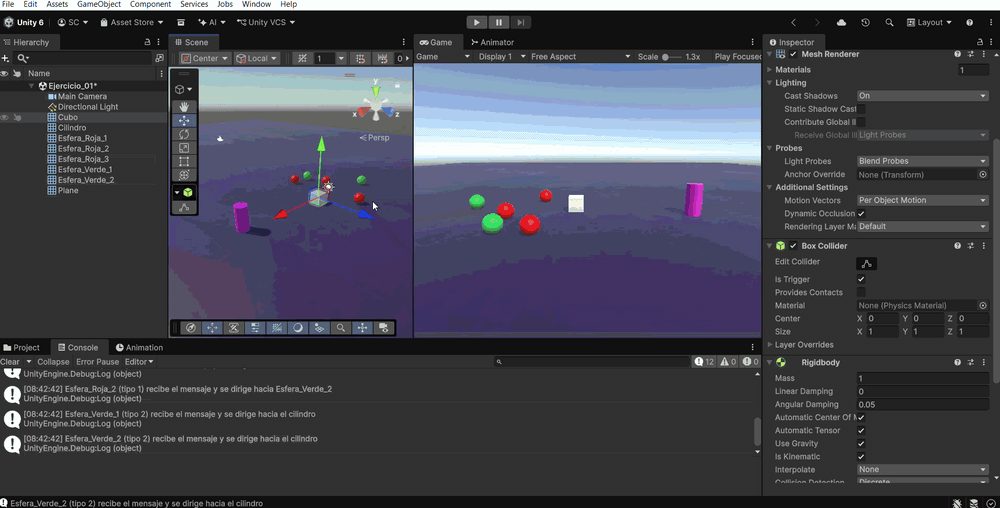
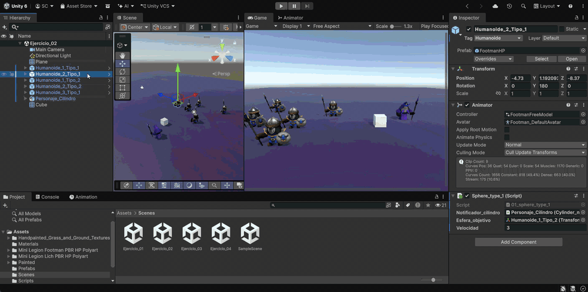
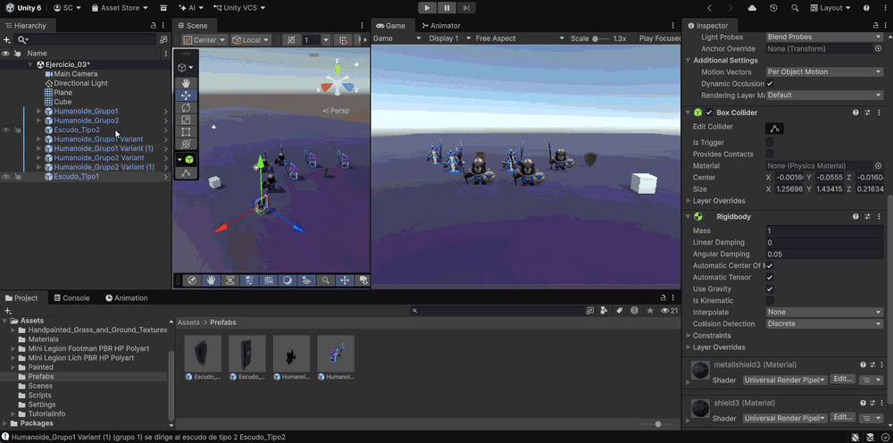
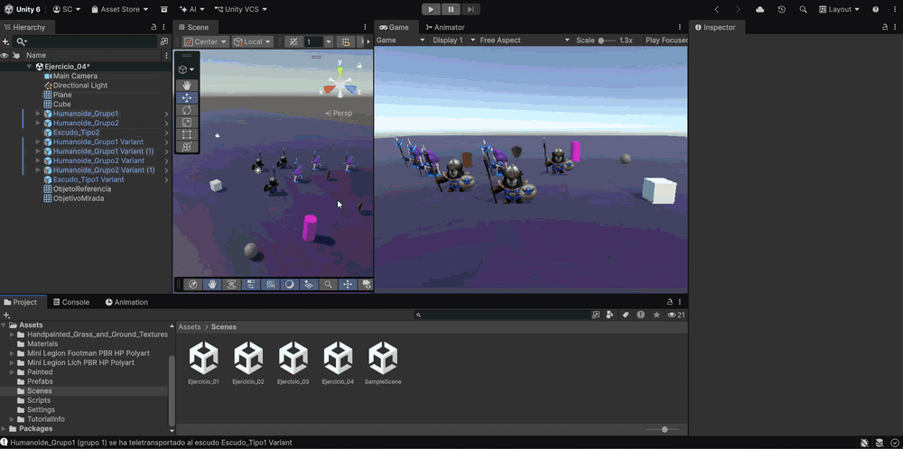
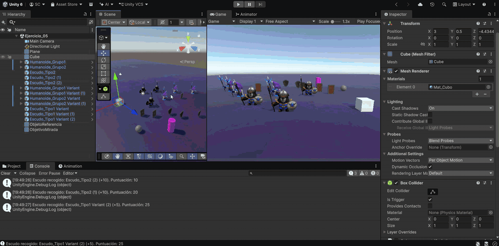
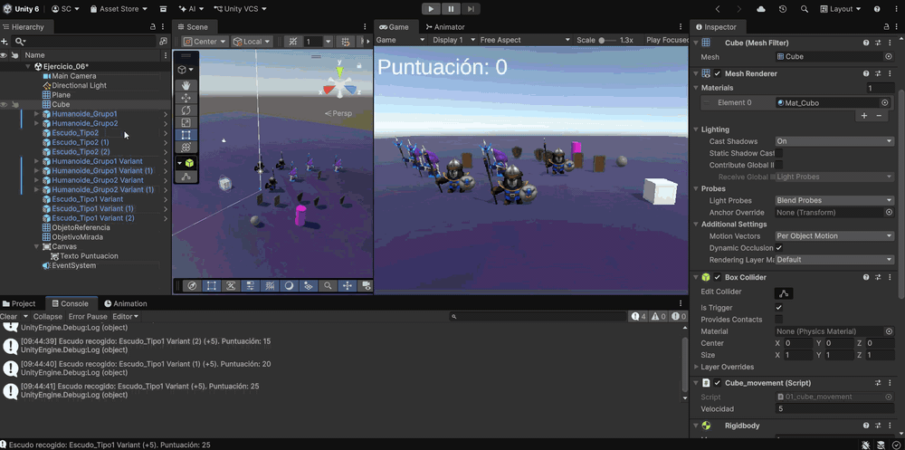
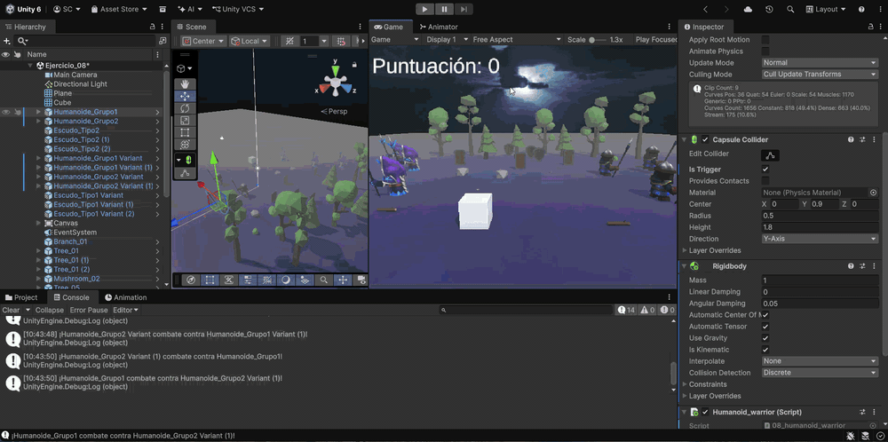
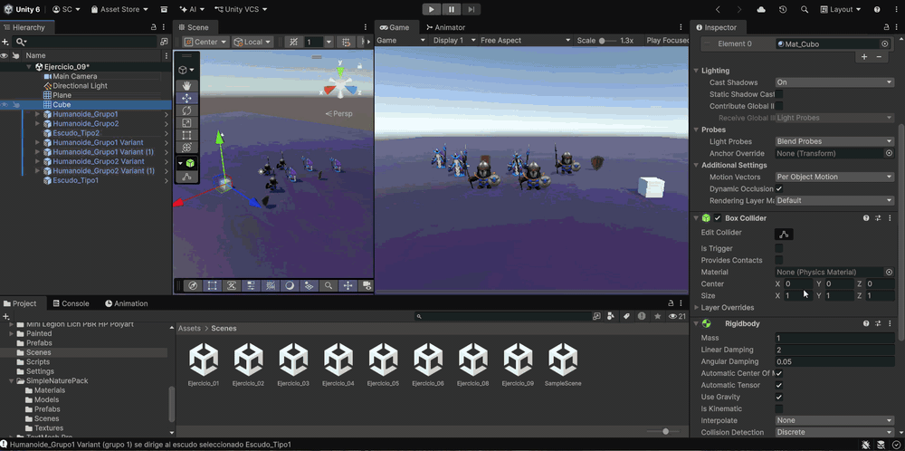

# Práctica 4 - Eventos y Patrón Observador en Unity

**Autor:** Sergio Rosales (alu0101635590@ull.edu.es)

Esta práctica de la asignatura **Interfaces Inteligentes** se centra en la comunicación entre objetos mediante **eventos** (patrón observador) en Unity. Un objeto *notificador* publica un mensaje cuando ocurre algo (una colisión, una aproximación o un cambio de puntuación) y los objetos *suscriptores* reaccionan ejecutando su propia función de callback, sin que el notificador necesite conocerlos. Sobre esta base se implementan mecánicas con humanoides y escudos, un sistema de recolección con puntuación y una interfaz de usuario.

---

## Configuración común de la escena

Para que los scripts funcionen se utilizan las siguientes **etiquetas** (*Tags*), que deben crearse en *Project Settings > Tags and Layers*:

| Etiqueta      | Se asigna a                              |
|---------------|------------------------------------------|
| `Cubo`        | El cubo controlado por el jugador        |
| `Humanoide`   | Todos los humanoides (grupo 1 y grupo 2) |
| `EscudoTipo1` | Los escudos de tipo 1                    |
| `EscudoTipo2` | Los escudos de tipo 2                    |

En los ejercicios 1 a 8 el cubo **no es un objeto físico**: tiene un `Rigidbody` marcado como **Is Kinematic** y su `Box Collider` con **Is Trigger** activado. Se mueve con `Rigidbody.MovePosition()` y, al ser un trigger cinemático, dispara `OnTriggerEnter` al tocar cualquier collider de la escena sin empujar a los objetos. En el ejercicio 9 el cubo pasa a ser un `Rigidbody` dinámico.

Todos los eventos siguen el mismo esquema:

- El notificador declara un `delegate` y un `event` de ese tipo, y lo invoca cuando ocurre la situación (comprobando antes que haya algún suscriptor).
- Los suscriptores se suscriben en `OnEnable()` con `+=` y se desuscriben en `OnDisable()` con `-=`, evitando así referencias a objetos destruidos y llamadas duplicadas.
- La función de callback activa una bandera o realiza una acción puntual; el movimiento continuo se hace en `Update()`.

---

## Ejercicios

### Ejercicio 1

> Crea una escena con 5 esferas, rojas las etiquetadas de tipo 1 y verdes las de tipo 2. Añade un cubo y un cilindro. Cuando el cubo colisiona con el cilindro, las esferas de tipo 1 se dirigen hacia una de las esferas de tipo 2 que fijes de antemano y las esferas de tipo 2 se desplazan hacia el cilindro.

La mecánica se reparte en cuatro scripts:

- **`01_cube_movement.cs`** (en el cubo): lee los ejes `Horizontal` y `Vertical` en `Update()` y aplica el movimiento en `FixedUpdate()` con `Rigidbody.MovePosition()`, igual que en la práctica anterior.
- **`01_cylinder_notifier.cs`** (en el cilindro): es el **notificador**. Declara el delegado `mensaje_colision` y el evento `on_cubo_colisiona`. En `OnTriggerEnter` comprueba con `CompareTag("Cubo")` que quien ha entrado es el cubo y, en ese caso, envía el mensaje a todos los suscriptores.
- **`01_sphere_type_1.cs`** (en las esferas rojas): recibe desde el Inspector la referencia al cilindro y la **esfera verde objetivo** fijada de antemano. Al recibir el mensaje activa la bandera `debe_moverse` y en `Update()` se desplaza hacia la esfera objetivo con `Vector3.MoveTowards()`.
- **`01_sphere_type_2.cs`** (en las esferas verdes): se suscribe al mismo evento, pero su callback las dirige hacia la posición del propio cilindro.

El destino se calcula manteniendo la altura (`y`) del propio objeto, de modo que se desplazan sobre el plano. El cilindro no sabe cuántas esferas hay ni de qué tipo son: cada grupo implementa su propia respuesta al mismo mensaje.

Script: [Assets/Scripts/01_cube_movement.cs](Assets/Scripts/01_cube_movement.cs)

Script: [Assets/Scripts/01_cylinder_notifier.cs](Assets/Scripts/01_cylinder_notifier.cs)

Script: [Assets/Scripts/01_sphere_type_1.cs](Assets/Scripts/01_sphere_type_1.cs)

Script: [Assets/Scripts/01_sphere_type_2.cs](Assets/Scripts/01_sphere_type_2.cs)

### Ejercicio 2

> Sustituye los objetos geométricos por humanoides.

Se sustituyen las esferas por modelos humanoides importados desde la Asset Store, sin cambiar la lógica. A cada humanoide se le añade un `Capsule Collider` y el script del grupo que le corresponda (`sphere_type_1` o `sphere_type_2`). Como el destino conserva la altura del objeto que se mueve, los humanoides se desplazan por el suelo.

Scripts reutilizados del ejercicio 1.

### Ejercicio 3

> Adapta la escena para que existan humanoides de tipo 1 y de tipo 2, así como escudos de tipo 1 y tipo 2, que son objetos físicos. Cuando el cubo choca con un humanoide de tipo 2, los del grupo 1 se acercan a un escudo seleccionado. Cuando el cubo choca con un humanoide del grupo 1, estos se dirigen hacia los escudos del grupo 2. Si un humanoide colisiona con un escudo, debe cambiar de color.

En este caso el notificador no es un único objeto, sino **cualquier humanoide**, por lo que los eventos se declaran como `static`:

- **`03_humanoid_contact_notifier.cs`** (en todos los humanoides): tiene un campo `tipo_humanoide` (1 o 2) configurable desde el Inspector y dos eventos estáticos, `on_cubo_toca_tipo_1` y `on_cubo_toca_tipo_2`. Detecta al cubo con `OnTriggerEnter` (cubo trigger de este ejercicio) y con `OnCollisionEnter` (cubo físico del ejercicio 9) y, según su tipo, lanza un evento u otro. Al ser estáticos, los suscriptores no necesitan referencia a ningún humanoide concreto.
- **`03_humanoid_group_1.cs`** (en los humanoides del grupo 1): se suscribe a los dos eventos y cada uno cambia su destino actual:
  - `on_cubo_toca_tipo_2`: el destino pasa a ser el `escudo_seleccionado`.
  - `on_cubo_toca_tipo_1`: el destino pasa a ser el escudo del grupo 2 (`escudo_tipo_2`) asignado en el Inspector.

  En `Update()` el humanoide se desplaza hacia el destino actual con `Vector3.MoveTowards()`, manteniendo su altura.
- **`03_humanoid_color_change.cs`** (en todos los humanoides): en `OnCollisionEnter` comprueba si el objeto con el que ha chocado es un escudo (`EscudoTipo1` o `EscudoTipo2`) y, en ese caso, cambia el color de los `Renderer` del humanoide. Los escudos tienen `Rigidbody` dinámico, de modo que son objetos físicos y el motor genera el evento de colisión al tocarlos.

Los escudos y humanoides se crean como **prefabs** para que todos los del mismo grupo compartan componentes y configuración.

Script: [Assets/Scripts/03_humanoid_contact_notifier.cs](Assets/Scripts/03_humanoid_contact_notifier.cs)

Script: [Assets/Scripts/03_humanoid_group_1.cs](Assets/Scripts/03_humanoid_group_1.cs)

Script: [Assets/Scripts/03_humanoid_color_change.cs](Assets/Scripts/03_humanoid_color_change.cs)

### Ejercicio 4

> Cuando el cubo se aproxima al objeto de referencia, los humanoides del grupo 1 se teletransportan a un escudo objetivo fijado de antemano. Los humanoides del grupo 2 se orientan hacia un objeto ubicado en la escena con ese propósito.

Aquí el evento no lo provoca una colisión, sino la **distancia**:

- **`04_proximity_notifier.cs`** (en el objeto de referencia): en cada `Update()` calcula la distancia al cubo con `Vector3.Distance()`. Cuando el cubo entra dentro de `distancia_activacion` lanza el evento `on_cubo_cerca`. La bandera `cubo_dentro` hace que el mensaje se envíe una sola vez por aproximación y no en cada frame mientras el cubo sigue cerca.
- **`04_humanoid_teleport.cs`** (grupo 1): al recibir el mensaje modifica directamente `transform.position` y coloca al humanoide en la posición del `escudo_objetivo`, manteniendo su altura.
- **`04_humanoid_look_at.cs`** (grupo 2): al recibir el mensaje se orienta hacia el `objeto_orientacion` con `transform.LookAt()`, usando un punto a su misma altura para que no se inclinen.

Script: [Assets/Scripts/04_proximity_notifier.cs](Assets/Scripts/04_proximity_notifier.cs)

Script: [Assets/Scripts/04_humanoid_teleport.cs](Assets/Scripts/04_humanoid_teleport.cs)

Script: [Assets/Scripts/04_humanoid_look_at.cs](Assets/Scripts/04_humanoid_look_at.cs)

### Ejercicio 5

> Implementar la mecánica de recolectar escudos que actualicen la puntuación del jugador. Los escudos de tipo 1 suman 5 puntos y los de tipo 2 suman 10. Mostrar la puntuación en la consola.

El script **`05_shield_collector.cs`** se añade al cubo:

- En `OnTriggerEnter` obtiene el objeto con el que ha chocado a través del collider (`other.gameObject`), como indica la ayuda del enunciado, y comprueba su etiqueta: `EscudoTipo1` suma `puntos_escudo_tipo_1` (5) y `EscudoTipo2` suma `puntos_escudo_tipo_2` (10).
- La función `recoger_escudo()` actualiza la puntuación, la muestra por consola junto al escudo recogido y elimina el escudo de la escena con `Destroy()`.

Script: [Assets/Scripts/05_shield_collector.cs](Assets/Scripts/05_shield_collector.cs)

### Ejercicio 6

> Partiendo del script anterior crea una interfaz que muestre la puntuación que va obteniendo el cubo.

Se separa la lógica de la puntuación de su representación, siguiendo de nuevo el patrón observador:

- **`06_score_manager.cs`** (en el cubo): parte del script anterior y añade el evento `on_puntuacion_cambiada(int puntuacion_actual)`, que se lanza cada vez que se recoge un escudo y envía la puntuación nueva.
- **`06_score_ui.cs`** (en el `Canvas`): recibe la referencia al `score_manager` y al componente de texto (`TMP_Text` de TextMeshPro). Se suscribe al evento y en el callback actualiza el texto con `"Puntuación: " + puntuacion_actual`. En `Start()` muestra la puntuación inicial (0).

Script: [Assets/Scripts/06_score_manager.cs](Assets/Scripts/06_score_manager.cs)

Script: [Assets/Scripts/06_score_ui.cs](Assets/Scripts/06_score_ui.cs)

### Ejercicio 8

> Genera una escena que incluya elementos que se ajusten a la escena del prototipo y alguna de las mecánicas anteriores.

Se ha creado una escena de **batalla** que reúne varias de las mecánicas de la práctica. En un escenario con elementos de decorado, dos ejércitos de tres humanoides (grupo 1 y grupo 2) están colocados frente a frente. El jugador mueve el cubo y recoge escudos, que suman puntos y se muestran en la UI (ejercicios 5 y 6). Al recoger el **primer escudo** empieza la guerra: cada humanoide se orienta hacia su enemigo y avanza hacia él hasta que se encuentran y combaten.

- **`08_war_notifier.cs`** (en el cubo): es el **notificador**. Declara el evento estático `on_empieza_guerra`. En `OnTriggerEnter` comprueba si el objeto recogido es un escudo (`EscudoTipo1` o `EscudoTipo2`) y, la primera vez, lanza el evento. La bandera `guerra_iniciada` evita que la guerra vuelva a empezar al recoger más escudos. Convive con `score_manager`, que se encarga de la puntuación y de eliminar el escudo.
- **`08_humanoid_warrior.cs`** (en los seis humanoides): cada uno tiene asignado su `enemigo` en el Inspector. Al recibir el mensaje se orienta hacia él con `transform.LookAt()` (a su misma altura) y activa la bandera `en_guerra`. En `Update()` avanza hacia delante con `transform.Translate(Vector3.forward * velocidad * Time.deltaTime)`. Cuando su trigger detecta a otro `Humanoide` en `OnTriggerEnter`, se detiene, cambia de color y muestra el combate por consola.

Para que los humanoides se detecten entre sí, tienen un `Rigidbody` **cinemático** y su `Capsule Collider` marcado como **Is Trigger**: así generan eventos de trigger al encontrarse, sin que la gravedad ni las fuerzas les afecten.

Script: [Assets/Scripts/08_war_notifier.cs](Assets/Scripts/08_war_notifier.cs)

Script: [Assets/Scripts/08_humanoid_warrior.cs](Assets/Scripts/08_humanoid_warrior.cs)

### Ejercicio 9

> Implementa el ejercicio 3 siendo el cubo un objeto físico.

Se reutiliza la escena y los scripts del ejercicio 3, cambiando únicamente el cubo:

- El `Rigidbody` del cubo deja de ser cinemático y su collider deja de ser trigger, por lo que pasa a ser un **objeto físico dinámico** afectado por la gravedad y las colisiones.
- **`09_cube_physics_movement.cs`** sustituye a `cube_movement`: lee la entrada en `Update()` y en `FixedUpdate()` mueve el cubo aplicándole fuerzas con `rb.AddForce()`, en lugar de fijar su posición.
- Como el cubo ya no es trigger, los humanoides lo detectan mediante `OnCollisionEnter`, caso que ya contemplaba `03_humanoid_contact_notifier`, por lo que el resto de la mecánica funciona igual.

Script: [Assets/Scripts/09_cube_physics_movement.cs](Assets/Scripts/09_cube_physics_movement.cs)

